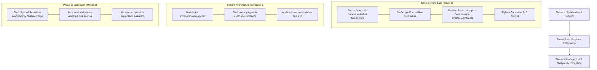

# EduChain Codebase Review & Architecture Report

Prepared for: **Mohsin**  
Date: November 9, 2026  
Repository: [EduChain Workspace](file:///c:/Users/saeed/Desktop/EduChain%20Workspace/Educhain-app)  
Active Branch: `Moshin-Coded`

---

## 1. Executive Summary

**EduChain** is a high-performance, gamified educational platform built specifically for secondary and higher secondary students (Grades 9 through 12, covering SSC and HSSC curriculums). The application combines mastery-based learning progression with active recall mechanisms ("The Mistake Forge"), real-time 1v1 and multiplayer arena battles, and global leaderboards.

### Platform Scorecard
| Dimension | Rating | Summary |
| :--- | :---: | :--- |
| **Feature Completeness** | **9.2 / 10** | Rich feature set: interactive stages, quiz engine, real-time battles, sound effects, admin CMS, analytics, and data import/export. |
| **Curriculum Content** | **9.0 / 10** | Over 3,800 lines of structured curriculum covering Math, Science, English, and Computer Science with detailed explanations. |
| **User Experience & UI** | **8.8 / 10** | Modern dark/light theme, sleek vector iconography, responsive layouts, audio-synthesizer feedback, and confetti animations. |
| **State Management** | **8.5 / 10** | Modular Zustand stores with local persistence and background cloud sync. |
| **Security & Authorization** | **4.5 / 10** | ⚠️ Client-side admin passcode, overly permissive Supabase RLS policies, and hardcoded fallback credentials. |
| **Code Architecture & Maintainability**| **6.8 / 10** | Admin page is a 2,460+ line monolith; ESLint reports 52 errors and 87 warnings; Google Font network build dependency. |

---

## 2. Technology Stack Overview

- **Framework**: [Next.js 16.4.3](https://nextjs.org) (App Router, Turbopack, Partial Prerendering enabled)
- **Frontend Core**: [React 19.3.0](https://react.dev) & [TypeScript 5](https://www.typescriptlang.org)
- **Styling**: [Tailwind CSS v4](https://tailwindcss.com) with CSS variables, Lucide React icons, and `canvas-confetti`
- **State Management**: [Zustand 5.0.16](https://zustand.docs.pmnd.rs) with `persist` middleware (`localStorage`)
- **Backend-as-a-Service**: [Supabase](https://supabase.com) (`@supabase/supabase-js` v2.118.0) for Auth, Database, and Realtime Channels (Presence & Broadcast)
- **Audio Synthesis**: Native HTML5 Web Audio API synthesizer (`src/lib/audio.ts`) providing zero-latency, zero-asset audio feedback

---

## 3. Detailed Component & Feature Review

### 3.1. Core Learning Journey & Stage Progression
- **File**: [`src/app/page.tsx`](file:///c:/Users/saeed/Desktop/EduChain%20Workspace/Educhain-app/src/app/page.tsx)
- **Component**: [`StageCard.tsx`](file:///c:/Users/saeed/Desktop/EduChain%20Workspace/Educhain-app/src/components/StageCard.tsx), [`NextQuestHero.tsx`](file:///c:/Users/saeed/Desktop/EduChain%20Workspace/Educhain-app/src/components/NextQuestHero.tsx)
- **Assessment**:
  - The curriculum roadmap is organized logically by Grade $\rightarrow$ Subject $\rightarrow$ Chapter $\rightarrow$ Stage.
  - Progression gating works effectively: users unlock subsequent stages upon scoring $\ge 70\%$ on current quizzes.
  - Grade switching is cleanly centralized into user profile settings to avoid UI clutter.

### 3.2. Assessment & Quiz Engine
- **File**: [`src/components/QuizModal.tsx`](file:///c:/Users/saeed/Desktop/EduChain%20Workspace/Educhain-app/src/components/QuizModal.tsx)
- **Assessment**:
  - Includes a 20-second per-question countdown timer with audio tick warnings when $\le 5$ seconds remain.
  - Keyboard shortcuts (`1`, `2`, `3`, `4`, and `Enter`/`Space`) are supported, improving accessibility and speed for power learners.
  - Confetti and audio cues reward successful completions, reinforcing engagement.
  - **Improvement**: If a user accidentally closes the modal or navigates away mid-quiz, state is not preserved. A brief confirmation prompt before aborting an in-progress quiz is recommended.

### 3.3. Active Recall: "The Mistake Forge"
- **File**: [`src/components/MistakeForge.tsx`](file:///c:/Users/saeed/Desktop/EduChain%20Workspace/Educhain-app/src/components/MistakeForge.tsx)
- **Assessment**:
  - Outstanding pedagogical feature. Every incorrect question from regular quizzes is cataloged in the user's personal mistake pool.
  - Students can filter by subject and status (`pending` vs. `mastered`) and practice active recall until the concept is mastered.
  - Directly addresses the forgetting curve without requiring external flashcard apps.

### 3.4. Real-time Multiplayer Battle Arena
- **Files**: [`src/app/battle/page.tsx`](file:///c:/Users/saeed/Desktop/EduChain%20Workspace/Educhain-app/src/app/battle/page.tsx), [`BattleArena.tsx`](file:///c:/Users/saeed/Desktop/EduChain%20Workspace/Educhain-app/src/components/battle/BattleArena.tsx), [`useMultiplayerStore.ts`](file:///c:/Users/saeed/Desktop/EduChain%20Workspace/Educhain-app/src/store/useMultiplayerStore.ts)
- **Assessment**:
  - Built with Supabase Realtime Channels (Broadcast + Presence).
  - Supports 1v1 duels and party rooms with custom round counts, question timers, and subject filters.
  - Dynamic combat HUD features health points (100 HP max), streak multipliers, opponent attack alerts, and a 3-second countdown.
  - **Identified Bug**: In [`CreateRoomModal.tsx`](file:///c:/Users/saeed/Desktop/EduChain%20Workspace/Educhain-app/src/components/battle/CreateRoomModal.tsx#L64), `Date.now()` is invoked during render, triggering React 19 / ESLint compiler purity violations.

### 3.5. Web Audio API Synthesizer
- **File**: [`src/lib/audio.ts`](file:///c:/Users/saeed/Desktop/EduChain%20Workspace/Educhain-app/src/lib/audio.ts)
- **Assessment**:
  - Generates chords and frequencies mathematically (e.g. F-major 9th chord for welcome, ascending sine arpeggios for correct answers, dissonance for errors).
  - Eliminates external `.mp3` asset network requests, guaranteeing instantaneous playback and offline reliability.
  - Includes user volume controls and sound toggling in settings.

### 3.6. Curriculum Studio / Admin Panel
- **File**: [`src/app/admin/page.tsx`](file:///c:/Users/saeed/Desktop/EduChain%20Workspace/Educhain-app/src/app/admin/page.tsx)
- **Assessment**:
  - Provides a full-featured content management suite: create/edit/delete classes, custom subjects, stages, and questions.
  - Features bulk CSV import and export with sample templates.
  - Includes user management and direct Supabase database synchronization.

---

## 4. Key Findings & Areas for Improvement

### 4.1. Security Vulnerabilities (High Priority)
1. **Client-Side Admin Passcode**:
   - In [`src/app/admin/page.tsx`](file:///c:/Users/saeed/Desktop/EduChain%20Workspace/Educhain-app/src/app/admin/page.tsx#L219), authentication is checked client-side using hardcoded strings (`"admin123"` and `"educhain@admin2026"`). Anyone inspecting JavaScript bundles or memory can bypass this check.
   - **Recommendation**: Secure `/admin` using Supabase server-side authentication with role-based access control (RBAC) via Next.js Middleware.
2. **Permissive Supabase Row-Level Security (RLS)**:
   - The embedded SQL script defines policies such as `CREATE POLICY "Allow public write custom_subjects" ... USING (true) WITH CHECK (true);`.
   - Anyone possessing the public anon key can alter or delete curriculum data directly.
   - **Recommendation**: Restrict `INSERT`, `UPDATE`, and `DELETE` on curriculum tables to authenticated admin users with specific claims.
3. **Hardcoded Supabase Credentials**:
   - [`src/lib/supabase/client.ts`](file:///c:/Users/saeed/Desktop/EduChain%20Workspace/Educhain-app/src/lib/supabase/client.ts#L3-L4) has fallback API keys hardcoded in source. If keys are rotated or should remain private, relying on in-code fallbacks poses a security risk.

### 4.2. Build & Infrastructure
1. **Google Fonts Network Build Dependency**:
   - [`src/app/layout.tsx`](file:///c:/Users/saeed/Desktop/EduChain%20Workspace/Educhain-app/src/app/layout.tsx) pulls `Geist` and `Geist_Mono` from Google Fonts at build time. When building inside sandboxes, proxies, or offline CI/CD pipelines, `next build` fails.
   - **Recommendation**: Bundle local fonts via `next/font/local` or supply standard CSS system font fallbacks (`ui-sans-serif, system-ui, sans-serif`).

### 4.3. Code Quality & Linting
1. **React 19 Impure Render Violations**:
   - In [`CreateRoomModal.tsx`](file:///c:/Users/saeed/Desktop/EduChain%20Workspace/Educhain-app/src/components/battle/CreateRoomModal.tsx), `Date.now()` is called during component evaluation. This must be moved inside the submit handler or initialized via a `useId()` / `useRef()` hook.
2. **Monolithic Admin Component**:
   - [`src/app/admin/page.tsx`](file:///c:/Users/saeed/Desktop/EduChain%20Workspace/Educhain-app/src/app/admin/page.tsx) spans **2,465 lines**. Extract the CSV parser, SQL generator, and stage tables into dedicated subcomponents under `src/components/admin/`.
3. **Excessive `any` Types**:
   - Over 11 instances of `any` in [`src/store/useCurriculumStore.ts`](file:///c:/Users/saeed/Desktop/EduChain%20Workspace/Educhain-app/src/store/useCurriculumStore.ts). Defining strict TypeScript interfaces for Supabase payload structures will improve type safety.

---

## 5. Technical Roadmap & Recommendations

---

## 6. Conclusion

EduChain demonstrates great ambition and thoughtful product execution. The combination of local-first resilience, engaging game loops, active recall, and zero-dependency audio synthesis gives the platform a solid foundation. Addressing the security gating on `/admin`, resolving build dependencies, and modularizing the admin studio will make this platform production-grade and ready to scale.
